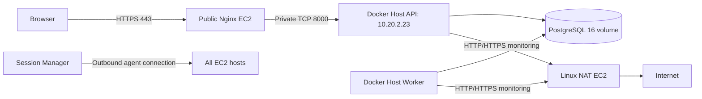

# UptimeForge MVP operations

This is a single-AZ deployment, not a highly available service. The repository
prepares deployment assets; none of these instructions authorizes a production
change. Obtain explicit approval before deploying, migrating data, modifying
Nginx, associating IAM profiles or changing AWS resources. Preserve the AWS Free
Plan requirement; no billing changes are authorized by these assets. Actual plan
compatibility is a release gate, as described below.

## Architecture and boundaries



The VPC is 10.20.0.0/16; private services are in 10.20.2.0/24. The existing SG
allows API ingress only from Nginx's SG. Production Compose binds API port 8000
only to the Docker Host's private IP. PostgreSQL has no host port; Worker has no
listener. SSH is not needed. ECR/SSM access depends on outbound HTTPS via the
working NAT and routes. Do not recreate networking to deploy the application.

Use an existing, approved temporary human profile to request an SSM session:

```bash
release_profile=REPLACE_WITH_APPROVED_SSO_PROFILE
aws sso login --profile "$release_profile"
aws sts get-caller-identity --profile "$release_profile" --region eu-north-1
# Use the existing Docker Host instance ID from the reviewed Terraform output:
aws ssm start-session --target INSTANCE_ID --profile "$release_profile" --region eu-north-1
```

The local workstation's AWS credentials are not container configuration. Do not
copy them to GitHub, EC2 files or .env.prod. Do not run Docker remotely through an
unprotected TCP socket.

## Current readiness gates

- ECR uptimeforge-api is deployed; `enable_cicd_iam=false` remains unchanged.
- Real GitHub OIDC claim diagnostics must be reviewed after their workflow is
  merged into main. Organization-approved provider inspection is still blocked
  by SCP p-po1vubeu; do not create a provider to bypass that restriction.
- The Docker Host still uses the shared SSM role. A separately approved dedicated
  profile migration is required before instance credentials can pull ECR images.
  Enabling the prepared IAM module alone does not associate a profile.
- Publishing and deployment workflows are not active. No permanent AWS keys
  are used as a workaround. An approved operator with repository-scoped push
  access can publish the linux/amd64 image; never assume the Terraform operator
  profile is authorized to publish before checking its approved permissions.
- DNS, certificates and Nginx reverse proxy activation remain operator decisions.
  Do not send Basic authentication credentials over public HTTP.

## Images and configuration

The Dockerfile pins the Python base digest, build backend and runtime constraints
in app/requirements.lock. CI uses those runtime constraints too. Dependency/base
updates require a reviewed lock/digest change and the complete test suite.

Build from app/ for linux/amd64 (the current EC2 hosts are x86_64). Every release
uses the same image for API and Worker:

```text
152680102458.dkr.ecr.eu-north-1.amazonaws.com/uptimeforge-api:sha-FULL_40_HEX_COMMIT_SHA
```

Tags are immutable. An already-published SHA should be verified and reused, not
overwritten. Keep running/rollback releases within ECR's 20-image retention
window. Record the resolved image digest as well as the Git commit. PostgreSQL
stays on official postgres:16-alpine; review minor updates separately.

Copy .env.prod.example to a protected .env.prod, replace every placeholder, and
set permissions to 600. Docker administrators can inspect container environment
values; restrict Docker and SSM access. Never print resolved Compose configuration
with real secrets in shared logs; use `config --quiet` for routine validation.

Choose the fresh-install or existing-installation procedure below explicitly.
For an upgrade, POSTGRES_VOLUME_NAME must be the **actual existing volume**, not
a guessed new name. Inspect the current database container's mounts before
approval. The external volume declaration refuses to silently provision an empty
database. POSTGRES_DB, POSTGRES_USER and POSTGRES_PASSWORD must match the existing
database; changing those image initialization variables does not rotate existing
database credentials. For a fresh install, choose new credentials and explicitly
create the approved volume once before starting PostgreSQL. URL-encode credentials
in DATABASE_URL and use hostname db.

The API needs a long random AUTH_PASSWORD; example REPLACE_ values are rejected.
Keep backups and release records outside the 20 GiB host disk where practical.
No secret file is committed or bundled into the application image.

Set NGINX_PRIVATE_IP to the actual private address of the Nginx EC2 host.
Only API trusts forwarded headers from that peer, so HTTPS browser writes pass
the existing same-origin checks. Never use wildcard proxy trust. The Nginx
template preserves the original Host header, including any external HTTPS port.

## Separately approved manual image publication

Use an organization-approved human session with short-lived credentials, such as
an already provisioned IAM Identity Center profile. Do not provision Identity
Center or change the organization as part of a release. The existing uptimeforge
AssumeRole profile is not sufficient evidence of a keyless source: its source
profile may use long-lived IAM-user keys. Do not use that chain for this path.
Before publishing, confirm account 152680102458, review the operator's approved
repository-scoped ECR push permissions, and obtain approval for the registry write.
If an approved temporary human session is unavailable, publishing remains blocked.
These commands were not executed during preparation. Run from a reviewed, clean Git checkout; do not label
uncommitted application changes with a commit SHA.

```bash
set -euo pipefail
release_profile=REPLACE_WITH_APPROVED_SSO_PROFILE
aws sso login --profile "$release_profile"
release_account=$(aws sts get-caller-identity --profile "$release_profile" --query Account --output text)
test "$release_account" = 152680102458
aws sts get-caller-identity --profile "$release_profile" --region eu-north-1
test -z "$(git status --porcelain)"
release_sha=$(git rev-parse HEAD)
release_repository=152680102458.dkr.ecr.eu-north-1.amazonaws.com/uptimeforge-api
docker build --platform linux/amd64 -f app/Dockerfile \
  -t "${release_repository}:sha-${release_sha}" app
aws ecr get-login-password --profile "$release_profile" --region eu-north-1 | docker login \
  --username AWS --password-stdin 152680102458.dkr.ecr.eu-north-1.amazonaws.com
# Registry write: only after explicit publication approval.
docker push "${release_repository}:sha-${release_sha}"
docker logout 152680102458.dkr.ecr.eu-north-1.amazonaws.com
```

For a SHA that already exists, verify its recorded digest and reuse it; do not
overwrite immutable tags. Record the published digest and use the same image in
API/Worker. This operator procedure does not provide the Docker Host with pull
permissions, bypass the SCP or activate GitHub AWS authentication. The future CI
publisher must use the reviewed repository-scoped OIDC role instead.

## Docker Host access independent of GitHub OIDC

ECR pull uses EC2 temporary instance credentials and does not require a GitHub
provider, publisher role or GitHub token. The approved dedicated Docker Host role
must retain AmazonSSMManagedInstanceCore, trust only ec2.amazonaws.com, and allow:

- ecr:GetAuthorizationToken on * (this action has no repository resource scope).
- ecr:BatchCheckLayerAvailability, ecr:BatchGetImage and
  ecr:GetDownloadUrlForLayer only on
  arn:aws:ecr:eu-north-1:152680102458:repository/uptimeforge-api.

The independent modules/docker-host-iam module has these scopes and never looks
up GitHub OIDC. enable_docker_host_iam creates its four IAM resources only;
associate_docker_host_profile is a separate explicitly approved migration flag.
Both default to false. Keep enable_cicd_iam=false. Follow the
[Docker Host IAM migration runbook](DOCKER-HOST-IAM.md), create/review the role
first, then approve association only to the existing Docker Host while retaining
SSM. Do not add ECR permissions to the shared SSM role: NAT and Nginx must not
receive them. The SCP remains intact.

Use an approved temporary human session for SSM access as well. On the host verify IMDSv2/instance-role credentials, no local
AWS key files or credential environment overrides, Docker Engine/Compose v2,
AWS CLI, Python 3, free disk/RAM, NAT HTTPS egress to ECR and Docker Hub, and SSM
agent health. Confirm the actual instance role with sts get-caller-identity; fail
closed on an unexpected account/role. For Nginx, verify private TCP 8000 and a
successful http://10.20.2.23:8000/health request from its host before TLS activation.

Run host commands from a private, operator-owned checkout/release directory on
the Docker Host. Verify local Docker context and the target host before changes.
Use an approved credential mechanism after the ECR pull role is associated:

```bash
aws sts get-caller-identity --region eu-north-1
aws ecr get-login-password --region eu-north-1 | docker login \
  --username AWS --password-stdin 152680102458.dkr.ecr.eu-north-1.amazonaws.com
```

This uses temporary instance-role credentials, not the workstation profile.
Protect Docker's credential storage or configure the ECR credential helper;
refresh login when its token expires. Do not print the password.

## Fresh installation — separately approved one-time initialization

Use this path only after verifying that there is no existing installation/data
on this host, no previous database container, and no volume requiring recovery.
A missing volume during an upgrade is a recovery incident, not a fresh install.
Review Docker context, host identity, existing containers/volumes and the release
image/digest. Obtain explicit approval for the new volume name, first database
initialization and Alembic migration. Docker Engine and Compose operators must
not run concurrent deployment commands during this procedure.

Prepare the protected .env.prod with the approved volume name, new strong database
credentials, URL-encoded DATABASE_URL and administrator credentials. Authenticate
and pull images using the approved instance role first. The following Bash block
is an operator procedure, not an automatic deployment script:

```bash
set -euo pipefail
# Validate privately; config JSON below goes only to an in-memory parser.
docker compose --env-file .env.prod -f compose.prod.yaml --profile tools config --quiet
docker info >/dev/null
release_volume=$(docker compose --env-file .env.prod -f compose.prod.yaml --profile tools config --format json | python3 -c 'import json,sys; print(json.load(sys.stdin)["volumes"]["pgdata"]["name"])')
release_volumes=$(docker volume ls --format '{{.Name}}')
if printf '%s\n' "$release_volumes" | grep -Fxq -- "$release_volume"; then
  echo 'STOP: volume already exists; review the existing-installation path.' >&2
  exit 1
fi
# One-time host storage change: execute only after explicit creation approval.
docker volume create --driver local --label uptimeforge.purpose=postgresql "$release_volume"
docker volume inspect "$release_volume" --format '{{.Name}} {{.Driver}}'
docker compose --env-file .env.prod -f compose.prod.yaml --profile tools pull db api worker migrate
# Starts only PostgreSQL; the official image initializes an empty data directory.
docker compose --env-file .env.prod -f compose.prod.yaml up -d --wait --wait-timeout 120 db
# Schema change: execute only after explicit initial-migration approval.
docker compose --env-file .env.prod -f compose.prod.yaml --profile tools run --rm --no-deps migrate
docker compose --env-file .env.prod -f compose.prod.yaml --profile tools run --rm --no-deps migrate alembic current
docker compose --env-file .env.prod -f compose.prod.yaml up -d --no-deps --wait --wait-timeout 120 api worker
```

Require migration exit code zero and the expected Alembic head before starting
API/Worker. Verify API /health, a real authenticated monitor/check cycle, worker
history and Nginx HTTPS. Create an approved baseline backup and verify an isolated
restore before declaring release readiness. If initialization or migration fails,
stop and investigate; preserve the created volume. Do not delete/recreate it or
retry this as a new installation. No volumes are automatically removed.

## Existing installation — approved upgrade procedure

After explicit deployment approval:

1. Inspect the running database container mount and match its volume name exactly
   to POSTGRES_VOLUME_NAME. Verify it with `docker volume inspect`; if absent or
   mismatched, stop. Never use the fresh-install creation command for an upgrade.
   Verify PostgreSQL major version 16 (a different major needs its own migration
   plan), free disk/RAM, database health and a restorable
   backup. Record the previous SHA, digest, Compose revision and Alembic revision.
2. Set the new APP_IMAGE in the private configuration. Run
   `docker compose --env-file .env.prod -f compose.prod.yaml --profile tools config --quiet`.
3. Pull without stopping running containers:
   `docker compose --env-file .env.prod -f compose.prod.yaml --profile tools pull api worker migrate`.
4. For initial adoption, review container names, project labels and database
   settings against the running Compose stack before any recreation. This file
   uses project name uptimeforge. Do not run two database containers on one volume.
5. Stop only API and Worker during a schema upgrade:
   `docker compose --env-file .env.prod -f compose.prod.yaml stop api worker`.
6. After migration-specific approval, invoke the one-off migration explicitly:
   `docker compose --env-file .env.prod -f compose.prod.yaml --profile tools run --rm --no-deps migrate`.
   Its exit code must be zero before startup. No migrations run implicitly in API.
7. Start the app services:
   `docker compose --env-file .env.prod -f compose.prod.yaml up -d --no-deps --wait --wait-timeout 120 api worker`.
   The existing database must already be healthy. Monitor `ps`, API /health,
   worker logs and a real monitor's check history. Health failures do not cause
   Docker to restart a running-but-unhealthy container automatically.
8. Verify Nginx-to-private-IP connectivity and HTTPS access before declaring the
   release usable. Run `docker logout` if temporary login storage should be cleared.

Never use down -v, volume rm, system prune --volumes, or recreate the database
volume during an update. A migration failure requires investigation and a reviewed
recovery decision; do not automatically downgrade the schema or restore backups.

## Rollback, backup and recovery

For an application-only rollback with a compatible schema, restore the recorded
previous APP_IMAGE, pull it, and recreate only API/Worker. Verify health and check
history. If the migration is incompatible, stopping services and restoring data
requires separate approval; a previous image alone is not a database rollback.
Initial migration 0001 creates the current schema; future migrations must state
compatibility and rollback constraints before release.

An approved backup can use a PostgreSQL custom-format dump without exposing
the database port or printing its password:

```bash
umask 077
docker compose --env-file .env.prod -f compose.prod.yaml exec -T db \
  sh -c 'exec pg_dump --format=custom --username="$POSTGRES_USER" "$POSTGRES_DB"' \
  > /SECURE_BACKUP_LOCATION/uptimeforge.dump
```

Check command success and use pg_restore --list to inspect the archive. Test
restoration into an isolated PostgreSQL 16 database and verify migrations, monitor
counts and API behavior. Encrypt and copy backups off-host through an approved
storage process. Define retention, recovery point/time objectives and a schedule;
none is automated here. Do not test restores against production or copy a live
PostgreSQL data directory as a substitute for a consistent backup.

## Proxy, health and security

deploy/nginx/uptimeforge.conf.example is a template, not an applied configuration.
Replace the domain and certificate paths; verify DNS and private connectivity;
validate with nginx -t before an approved reload. Its access format omits query
strings and authorization headers. Configure log rotation and Basic-auth rate
limiting before public use. The existing bootstrap currently serves a test page.

API /health performs a database query. Worker health checks database access;
they do not prove scheduling progress. Alert on stalled check history, worker
errors, database/disk growth, unhealthy containers and NAT/SSM availability.
Logs rotate at 10 MiB × three files per container. Start memory limits are DB
512 MiB, API 384 MiB and Worker 256 MiB, leaving headroom on t3.small. CPU limits
are 0.5 per service; validate burst-credit use and memory under realistic load.
Check history is not yet pruned automatically; 20 GiB EBS needs growth monitoring.

The application rejects private/metadata addresses, dangerous URL forms and DNS
answers; each check pins a validated public IP while preserving TLS hostname
verification. Body size, redirects and deadlines are constrained. Unit tests cover
these SSRF protections. Network routing overrides remain an operator risk; review
them before allowing arbitrary public checks. Do not relax these controls to reach
internal services. Keep one authenticated administrator, restrict access and avoid
describing this single-tenant MVP as a multi-tenant production SaaS.

## AWS Free Plan verification gate

The deployment assets add no AWS resources, but do not establish zero cost or
Free Plan eligibility for existing EC2, EBS, ECR, public IPv4 and data transfer.
Verify the actual account plan and remaining credits before each approved release:

```bash
aws freetier get-account-plan-state --profile APPROVED_TEMP_PROFILE --region us-east-1
```

Require FREE/ACTIVE if remaining on Free Plan is mandatory, and review remaining
credits, expiry and expected consumption with the billing owner. An empty Free
Tier usage response does not mean zero cost. Do not infer this account's plan
solely from Organizations membership; inspect the API and Billing console.
See [Choosing a plan](https://docs.aws.amazon.com/awsaccountbilling/latest/aboutv2/free-tier-plans.html).
No plan upgrade, organization membership or billing change is authorized here.

## Troubleshooting

- ECR AccessDenied: verify the host's actual role and repository-scoped pull policy;
  keep the SCP intact and do not install static credentials.
- SSM offline or pull timeouts: inspect the existing NAT route, HTTPS egress, agent
  health and IAM association. Do not open SSH as a workaround.
- API unhealthy: inspect sanitized app logs, db health, credentials and migration
  revision; no auto-migration occurs during web startup.
- Worker healthy but checks stall: inspect worker logs, due monitors, database locks
  and actual check timestamps. The DB health probe does not detect a stuck scheduler.
- Missing external volume on an upgrade: stop and identify/recover the existing
  mount. Only a verified fresh installation can use the approved creation path.
- Disk pressure: inspect log and check-history growth; prune only reviewed unused
  images without volumes, and preserve rollback candidates and data backups.
